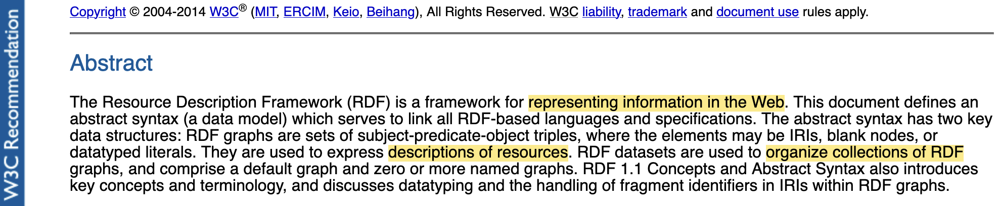
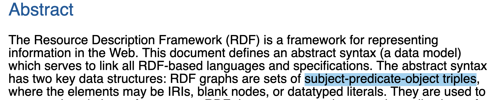
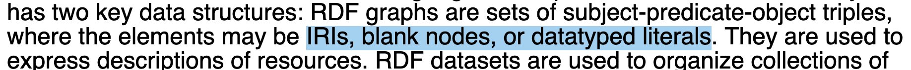

class: middle, center, title-slide
<!-- Le gros titre de la présentation -->
# From SHACL Constraints to Form-Based RDF Authoring
### An RDF Mapping Language (RML) use case

Christal Mangolopa · ULiège

<!-- TODO: vérifier que le titre correspond à celui envoyé à Lena -->

???
~0:20. One sentence about you: master's student at ULiège, thesis on generating forms from SHACL shapes.
Say upfront that at the end you are looking for a few people to try the tool.

---
class: middle

# Knowledge graphs

.statement[
A set of **facts** about things, expressed as **relations** between them.
]

.ph[Small picture: a few nodes and edges, or a well-known KG (Wikidata) screenshot]

???
~0:40. Definition from your thesis outline: directed, heterogeneous multigraph.
Heterogeneous: nodes are different kinds of entities. Multigraph: several edges between two nodes.
Use case to name: Wikidata, library catalogues, research data portals [TBD: pick one the audience knows].

---
class: middle, center

<!-- Read RDF definition.
-> DESCRIBE data + ORGANIZE data is where I see why *you* might be interested in working with RDF, if you are not already.
However, my work is not on the use of RDF dataset directly, but my era is in the creation, the authoring of RDF graphs. 
-->


???
RDF: the W3C data model for knowledge graphs.

---



- Describe data
- Organise data
- Share data on the Web

???
"Share data on the Web" is the closest to the spec's "representing information in the Web".
Your angle: these are reasons *they* use RDF. Your work is earlier: **creating** RDF graphs.

---
# Structure of RDF graphs


---


???
IRI: a global identifier, like a URL. Two graphs using the same IRI talk about the same thing.
This is what makes linking possible, but it is a choice: nothing links automatically.
Blank node: a node without a global name. Literal: a value with a datatype.

---
# An example

.cols[
.col[
```turtle
@prefix ex:   <http://example.org/> .
@prefix foaf: <http://xmlns.com/foaf/0.1/> .
@prefix dc:   <http://purl.org/dc/elements/1.1/> .

ex:1984 a dc:BibliographicResource ;
    dc:title "1984" ;
    dc:creator ex:George_Orwell .

ex:George_Orwell a foaf:Person ;
    foaf:name "George Orwell" .
```
]
.col[
<iframe src="test/rdf-graph.html?src=books.ttl" frameborder="0" style="width: 100%; height: 420px;"></iframe>
]
]

???
~1:00. Prefix: `ex:1984` is short for `<http://example.org/1984>`. Only an abbreviation.
Point at one triple in the code and the same edge in the graph.

---
# One graph, several serialisations

.cols[
.col[
**Turtle**
```turtle
ex:1984 dc:title "1984" .
```
**N-Triples**
```
<http://example.org/1984>
  <http://purl.org/dc/elements/1.1/title> "1984" .
```
]
.col[
**JSON-LD**
```json
{ "@id": "http://example.org/1984",
  "http://purl.org/dc/elements/1.1/title": "1984" }
```
]
]

.footnote[Also RDF/XML, TriG, N-Quads…]

???
RDF is the abstract model (the graph). Turtle, N-Triples, JSON-LD, RDF/XML are serialisation formats:
the same graph written down in different ways. Keep this to 30 s.

---
class: middle

# Not every graph is the data we want

- Every book has **exactly one** title
- A title is a **string**
- A creator must be a **person**

???
~0:45. Why constraints: data quality, agreement between partners, an application profile
[TBD: one example from the audience's world, e.g. a metadata profile they use].

---
# SHACL: Shapes Constraint Language

.cols[
.col[
- W3C Recommendation (2017)
- Describes the **shapes** a graph is allowed to take
- Is itself written **in RDF**
- Used for **validation**
]
.col[
.ph[Screenshot: SHACL spec title / abstract (w3.org/TR/shacl)]
]
]

.footnote[Validators: pySHACL, Apache Jena, TopBraid SHACL, shacl-engine (JS), SHACL Playground]

???
Shapes graph + data graph → validation report. Name one validator you actually used (shacl-engine is the one in your tool).

---
# A SHACL shape

```turtle
ex:BookShape a sh:NodeShape ;
    sh:targetClass dc:BibliographicResource ;
    sh:property [
        sh:path dc:title ;
        sh:datatype xsd:string ;
        sh:minCount 1 ; sh:maxCount 1 ] ;
    sh:property [
        sh:path dc:creator ;
        sh:class foaf:Person ;
        sh:minCount 1 ] .
```

???
Map each line back to the three rules of the previous slide. Full file: test/books-shapes.ttl.

---
class: middle

# From validating to authoring

.statement[
If we know which graphs are **valid**,
we know what the user **can create**.
]

???
~0:45. The key idea. But: a validation language is not automatically an authoring language.
Keep that sentence for later (RML part).

---
# Demo: the shape becomes a form

<iframe src="test/form.html?shapes=books-shapes.ttl" frameborder="0" style="width: 100%; height: 470px;"></iframe>

???
~1:30, LIVE. Fill a title, add a creator. Show the Turtle on the right.
Show "create a new person" vs "link an existing one" if available: first hint of the authoring problems.
Backup: screenshot or video [TBD] if the iframe fails.

---
# My work

.statement[
A **form-based platform** for RDF authoring,
with **SHACL** as entry point:
create nodes and their connections, output an RDF graph.
]

.ph[Small pipeline: raw data → (RML mapping) → RDF → publish → link → analysis. Highlight where you stand]

???
This also answers the question "where does this fit in the data process?":
you are at the creation step, not the integration or analysis.

---
# Evaluating existing SHACL form generators

- Which ones? .ph[Logos / screenshots of the generators compared]
- What do we test?
- What counts as "working"?

No shared benchmark for form generators that I could find.

???
~1:00. Name the generators [TBD from your matrix].
Be careful with the claim: "that I could find", not "does not exist".

---
# From pass/fail to behaviours

.cols[
.col[
**Tests:** W3C SHACL test suite (unit tests per feature)

**First idea:** implemented / not implemented

**Ended with:** observing behaviours, then classifying them
]
.col[
.ph[Screenshot: extract of the SHACL comparison matrix]
]
]

???
~1:15. The categories [TBD: list them, from Ch. 3]. Example of a case that is neither pass nor fail
(e.g. path-alternative-001: not representable as a form root).

---
class: middle

# An interesting use case: RML

Challenging for…

1. **RDF authoring**: several nodes, reused nodes, a real graph
2. **SHACL**: its shapes use advanced features
3. **The output itself**: the RDF we create is *executable*

???
Point 3 is the fun one: the generated graph is a program, so we can check it by running it.

---
# RML: RDF Mapping Language

.cols[
.col[
```
id,title,author
1,1984,George Orwell
```
]
.col[
```turtle
<#BookMap> a rml:TriplesMap ;
  rml:logicalSource [ ... ] ;
  rml:subjectMap [
    rml:template "http://example.org/{id}" ] ;
  rml:predicateObjectMap [
    rml:predicate dc:title ;
    rml:objectMap [ rml:reference "title" ] ] .
```
]
]

**Data + mapping → engine (e.g. RMLMapper) → RDF**

.footnote[Mappings can also be written in YARRRML (YAML syntax).]

???
~1:30. A TriplesMap says, for each row: what is the subject, which predicates, which objects.
The mapping is itself an RDF graph, and the RML specification ships SHACL shapes for it.
TODO: replace by Lena's data if she sends some. Check the snippet runs (RMLTC0001a-like).
Correction to keep in mind: YARRRML is a syntax, the engine is RMLMapper (or Morph-KGC, SDM-RDFizer…).

---
# Demo: writing a mapping in the form

<iframe src="test/form.html?shapes=rml/core-authoring.ttl,rml/io.ttl,rml/authoring-overlay.ttl&ns=http://example.org/mapping/" frameborder="0" style="width: 100%; height: 470px;"></iframe>

???
~2:00. Needs the RML shapes copied to test/rml/. Build the BookMap from the previous slide.
Show at least: choosing the kind of objectMap (sh:or), reusing a TriplesMap (parentTriplesMap).
Backup: pre-recorded video [TBD]. Maybe pre-load values (&values=...) to save time.

---
# What RML pushed forward

.cols[
.col[
**Handled now**
- several roots (TriplesMaps)
- structure declared elsewhere (`sh:targetObjectsOf`)
- choices (`sh:or`, alternative paths)
- create / link / reuse a node
]
.col[
**Not yet**
- validation-only shapes still visible
- not every SHACL feature of the test suite
- [TBD]
]
]

.ph[Screenshot: same RML shapes in the original shacl-form vs the fork]

???
~1:15. RML did not trigger every SHACL feature, but it required authoring capabilities
that SHACL alone does not describe. Tone: "a step further", not "beyond the state of the art".
Numbers [TBD]: x/y SHACL tests, x/y RML test cases.

---
class: middle

# Try it!

The tool still needs **human testing**. A short guided session:

1. Write your own SHACL shapes, see them become a form → *learn SHACL*
2. Fill the form, get your RDF
3. Write a mapping, see your data become RDF → *learn RML*

.ph[QR code / link to the sign-up form]

???
~0:45. Duration [30–45 min], period [TBD]. Results anonymised, used in the thesis evaluation.
Put the link in the meeting chat too.
TODO: write the step-by-step tutorial for filling a mapping (see what Jakub did).

---
class: middle, center

# Thank you, questions?

github.com/christalisation/darmstadt-shacl-form

.ph[Contact / demo link]
