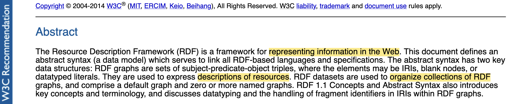
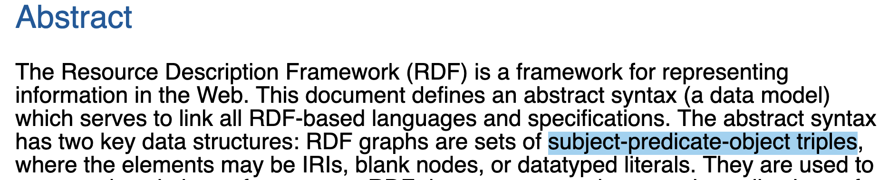
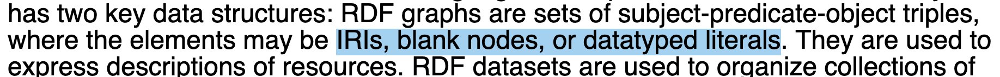

class: middle, center, title-slide
<!-- Le gros titre de la présentation -->
# RML SHACL form
TODO: aller reprendre le titre donné à Lena

---
class: middle, center

<!-- Read RDF definition.
-> DESCRIBE data + ORGANIZE data is where I see why *you* might be interested in working with RDF, if you are not already.
However, my work is not on the use of RDF dataset directly, but my era is in the creation, the authoring of RDF graphs. 
-->

TODO: ajouter une intro en plus ?

---

- Describe data, 
- organize data, and 
- share data in the Web. 
(TODO: or decribe in the web? ou bien share in the web ?)

---
# Structure of RDF graphs

---

---
<!-- Next slide: how to write RDF ?
- 
- show the visual repr of an exemple VS its diff serialisation
 -->

